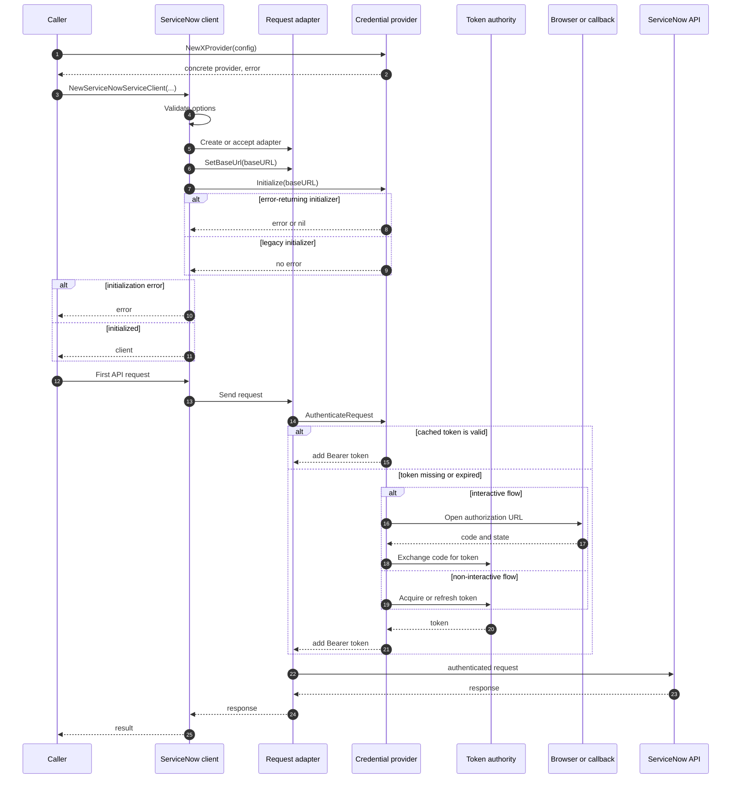

# Credential package blueprint

> Current design blueprint for the `credential` package. The package does not
> exist yet. ADR 022 is the decision record; this page is the implementation
> plan, not a shipped API reference.

## 1. Scope

The package implements every inbound ServiceNow REST API authentication method:

- Basic authentication.
- Static Bearer tokens supplied by the caller.
- API key.
- HMAC.
- Mutual TLS.
- Authorization code, for public and confidential clients.
- Client credentials.
- Resource owner password credentials (ROPC).
- JWT bearer.
- Third-party token grant, also called external OIDC authentication.

The package excludes:

- Implicit grant.
- Device authorization, which ServiceNow does not document for inbound REST
  API authentication.
- Browser-based SAML/SSO and cookie sessions.
- Client-side validation of external OIDC signatures or claims.
- Token introspection.

The package is one public package in the existing Go module. Protocol code
stays in `internal/oauth2`. The package is additive in v2; `credentials/` is
removed in v3.

## 2. Package and vocabulary

| Term                    | Meaning                                                                                                                                    |
| ----------------------- | ------------------------------------------------------------------------------------------------------------------------------------------ |
| Provider                | The Kiota-facing object passed to the client. Constructors return concrete types that implement `authentication.AuthenticationProvider`. |
| Credential              | The unexported token lifecycle for one OAuth flow. Callers never construct it.                                                             |
| Direct provider         | A provider that authenticates each request without a token lifecycle: Basic, static Bearer, API key, and HMAC.                             |
| Token authority         | The entity that issues the token. It is ServiceNow's OAuth server for native grants, or the external IdP for external OIDC authentication. |
| External IdP            | The third-party identity provider that issues the token for the third-party token grant.                                                   |
| Third-party token grant | ServiceNow's inbound OAuth mechanism that accepts an ID token or user access token from a trusted external IdP.                            |

The package is named `credential`, singular. Do not add `credentials2`, `auth`,
or a submodule.

## 3. Flow matrix

| Flow                              | Constructor                    | Lifecycle    | Request authentication           | Defaults and constraints                                                                       |
| --------------------------------- | ------------------------------ | ------------ | -------------------------------- | ---------------------------------------------------------------------------------------------- |
| Basic                             | `NewBasicProvider`             | Direct       | `Authorization: Basic`           | Retains the password for every request. Use it for development or controlled integrations.     |
| Static Bearer                     | `NewBearerProvider`            | Direct       | `Authorization: Bearer`          | The caller supplies the token. No cache, refresh, or revocation.                               |
| API key                           | `NewAPIKeyProvider`            | Direct       | `x-sn-apikey` header             | Query placement, a custom name, and a prefix are opt-ins.                                      |
| HMAC                              | `NewHMACProvider`              | Direct       | `x-sn-hmac-signature-256` header | SHA-256, base64, header or query placement, a custom signer, and an optional key ID.           |
| Mutual TLS                        | `NewMTLSHTTPClient`            | Transport    | Client certificate               | Pass the returned client through `WithHTTPClient`. Not a provider.                             |
| Authorization code (public)       | `NewAuthorizationCodeProvider` | Shared OAuth | Bearer token                     | No client secret; S256 PKCE; local callback by default.                                        |
| Authorization code (confidential) | `NewAuthorizationCodeProvider` | Shared OAuth | Bearer token                     | Secret goes only to the token endpoint; secret in the authorization URL is an explicit opt-in. |
| Client credentials                | `NewClientCredentialsProvider` | Shared OAuth | Bearer token                     | Re-acquires when the authority issues no refresh token.                                        |
| ROPC                              | `NewROPCProvider`              | Shared OAuth | Bearer token                     | Not recommended; discards the password after the first token.                                  |
| JWT bearer                        | `NewJWTBearerProvider`         | Shared OAuth | Bearer token                     | Caller assertion or SDK signer; RS, ES, and HS algorithms.                                     |
| External OIDC                     | `NewExternalOIDCProvider`      | Shared OAuth | Bearer token                     | ID token by default; access token opt-in; lazy discovery; no validation.                       |

## 4. Public surface

The core exported types:

```go
package credential

import (
    "context"
    "net/http"
    "time"

    "github.com/microsoft/kiota-abstractions-go/authentication"
)

type Initializer interface {
    Initialize(baseURL string) error
}

type Revoker interface {
    Revoke(ctx context.Context) error
}

type ProviderConfig struct {
    HTTPClient   *http.Client
    AllowedHosts []string
}

type TokenStore interface {
    Load(ctx context.Context, key TokenKey) (*Token, error)
    Save(ctx context.Context, key TokenKey, token *Token) error
    Delete(ctx context.Context, key TokenKey) error
}

type TokenKey struct {
    BaseURL    string
    ClientID   string
    Flow       Flow
    Scopes     string
    SessionKey string
}

type Token struct {
    AccessToken  string
    RefreshToken string
    IDToken      string
    TokenType    string
    Scope        string
    ExpiresAt    time.Time
}

type Flow int

const (
    FlowUnknown Flow = iota
    FlowAuthorizationCode
    FlowClientCredentials
    FlowROPC
    FlowJWTBearer
    FlowExternalOIDC
)

func (f Flow) String() string {
    switch f {
    case FlowAuthorizationCode:
        return "authorization_code"
    case FlowClientCredentials:
        return "client_credentials"
    case FlowROPC:
        return "ropc"
    case FlowJWTBearer:
        return "jwt_bearer"
    case FlowExternalOIDC:
        return "external_oidc"
    default:
        return "unknown"
    }
}
```

`Flow` is an integer-backed enum. `FlowUnknown` is the zero value and is
invalid for a token key; a provider sets a known flow before it keys a token.
The numeric values are stable because they key persisted tokens: append new
flows, and never reorder or renumber existing values. `String()` provides
stable names for diagnostics.

`TokenKey.Scopes` is the sorted, space-joined scope string, so scope order does
not create duplicate entries. `SessionKey` is empty for machine flows and
required for user-specific flows when persistence is enabled.

Every concrete provider type implements Kiota's
`authentication.AuthenticationProvider` interface, whose method is
`AuthenticateRequest`. A direct provider mutates the request; an OAuth provider
sets a Bearer token on it.

Constructor inventory:

```go
func NewBasicProvider(BasicConfig) (*BasicProvider, error)
func NewBearerProvider(BearerConfig) (*BearerProvider, error)
func NewAPIKeyProvider(APIKeyConfig) (*APIKeyProvider, error)
func NewHMACProvider(HMACConfig) (*HMACProvider, error)
func NewClientCredentialsProvider(ClientCredentialsConfig) (*ClientCredentialsProvider, error)
func NewROPCProvider(ROPCConfig) (*ROPCProvider, error)
func NewJWTBearerProvider(JWTBearerConfig) (*JWTBearerProvider, error)
func NewAuthorizationCodeProvider(AuthorizationCodeConfig) (*AuthorizationCodeProvider, error)
func NewExternalOIDCProvider(ExternalOIDCConfig) (*ExternalOIDCProvider, error)

func NewMTLSHTTPClient(MTLSConfig) (*http.Client, error)
func NewMemoryTokenStore() *MemoryTokenStore
```

Each provider constructor takes its config by value and returns a concrete
provider. The concrete types implement Kiota's interface and expose only the
optional capability methods they support. The client accepts the
`authentication.AuthenticationProvider` interface; the constructors return
concrete values. The caller can assign a provider to the interface without
losing the concrete type. `MemoryTokenStore` is the exported concrete type
behind `NewMemoryTokenStore`.

Signer and callback extension points:

- `HMACSigner` receives the request before the authentication parameter is
  added and returns the header or query value. The default signer owns the
  ServiceNow body canonicalization.
- `JWTSigner` builds and signs an assertion from claims. The package provides
  RSA, ECDSA, and HMAC signer constructors and rejects algorithms outside the
  ServiceNow list.
- `AuthorizationCodeConfig.Callback` lets a web application own the redirect.
  The provider still generates and validates state and PKCE.

No exported credential type, `BaseAccessTokenProvider`, `Authority`, or
package-specific provider interface exists. The concrete provider types,
provider configs, and `MemoryTokenStore` are exported. `OAuthError` is exported
so callers can use `errors.As`.

`ProviderConfig` carries transport settings only. Do not grow it into a shared
option bag.

OAuth configs include an optional `ClientAuthMethod`. The default is
`client_secret_post` for ServiceNow native flows; `client_secret_basic` and
`none` are supported. External OIDC prefers the IdP's advertised
`token_endpoint_auth_methods_supported` value and accepts an explicit override.

Protocol work stays in `internal/oauth2`. The implementation needs an
authorization URL builder that omits the client secret by default, and it can
reuse the existing JWT bearer exchange and client authentication. Make
`invalid_grant` detection explicit for the lifecycle. External IdP token
exchanges use the same client with the IdP's endpoints.

## 5. Client integration

The caller builds a provider, then builds the client with the instance URL:

```go
provider, err := credential.NewClientCredentialsProvider(credential.ClientCredentialsConfig{
    ClientID:     os.Getenv("SERVICENOW_CLIENT_ID"),
    ClientSecret: os.Getenv("SERVICENOW_CLIENT_SECRET"),
    Scopes:       []string{"useraccount"},
})
if err != nil {
    return err
}

client, err := servicenowsdkgo.NewServiceNowServiceClient(
    servicenowsdkgo.WithURL(os.Getenv("SERVICENOW_URL")),
    servicenowsdkgo.WithAuthenticationProvider(provider),
)
if err != nil {
    return err
}
```



Direct providers skip the token authority branch: `AuthenticateRequest` sets
their header or query parameter and the request continues. Interactive
providers open the browser during token acquisition, not during construction.
If the provider does not implement `Initialize(string) error`, the client falls
back to the legacy `Initialize(string)` method and returns `ErrEmptyURI` when
the URL is empty.

Initialization rules:

- `Initialize("")` returns `ErrEmptyURI` for a provider that needs a token
  endpoint.
- A direct provider implements a no-op and returns nil.
- A second call with the same URL does nothing.
- A second call with a different URL returns `ErrAlreadyInitialized`.
- A provider that needs a URL and is used before initialization returns
  `ErrNotInitialized`.
- A legacy provider with no URL returns `ErrEmptyURI` before the fallback runs.

The client initializes the configured provider after it resolves the request
adapter, whether it creates the adapter or accepts one. A caller that supplies a
custom request adapter must make sure that adapter uses the same provider; the
client still initializes the provider it was given.

## 6. Shared token lifecycle

Every OAuth flow uses the same unexported lifecycle. The lifecycle owns the
cache, expiry check, refresh, persistence, revocation, and single-flight
locking. A flow supplies hooks for initial acquisition, refresh, revocation,
and token normalization.

### 6.1 State transitions

| State             | Condition                   | Action                                                                                                                                                                                                        |
| ----------------- | --------------------------- | ------------------------------------------------------------------------------------------------------------------------------------------------------------------------------------------------------------- |
| No token          | Cache miss                  | Acquire through the flow hook.                                                                                                                                                                                |
| Valid             | `now < ExpiresAt - skew`    | Use the access token.                                                                                                                                                                                         |
| Expiring          | `now >= ExpiresAt - skew`   | Refresh when a refresh token exists; otherwise re-acquire for client credentials and SDK-built JWT assertions, or return `ErrReauthRequired` for interactive flows, ROPC, and caller-supplied JWT assertions. |
| `invalid_grant`   | Refresh rejected            | Clear the token. Non-interactive grants that can acquire a new token re-acquire once. ROPC, interactive grants, and caller-supplied JWT assertions return `ErrReauthRequired`.                                |
| Transient failure | Network error, 5xx, timeout | Return the error and keep the token. Use the token if it is still valid.                                                                                                                                      |
| Revoked           | `Revoker` call              | Clear the local token. A missing endpoint clears and succeeds; a protocol failure returns the error and keeps the token.                                                                                      |

A refresh response that omits a refresh token keeps the existing refresh token.
A response that omits an ID token keeps the existing ID token only when it is
still unexpired.

### 6.2 Token key and persistence

The key includes:

- Base URL, normalized to scheme and host without a trailing slash.
- Client ID.
- Flow.
- Sorted, space-joined scopes.
- Session key for user-specific flows.

The default store is in memory and scoped to the provider. Persistence is
opt-in through `TokenStore`. A custom store is responsible for its own
concurrency safety. `Load` returns `(nil, nil)` when no token exists. Store
errors are best-effort: a load error is a cache miss, and a save error does not
fail the request.

User-specific flows require a session key when a store is configured. Use a
stable caller-owned session identifier, never a password, token, or raw
authorization URL.

### 6.3 Single-flight and cancellation

Acquisition and refresh are keyed by `TokenKey`. Concurrent requests share one
attempt. A waiter that cancels stops waiting, but the shared attempt continues
for the other callers. A failed attempt is not cached as a permanent failure;
the next request can retry.

## 7. Flow contracts

### 7.1 Basic

`BasicConfig`:

- `ProviderConfig`
- `Username`
- `Password`

Behavior:

- Validate that both fields are non-empty.
- `Initialize` is a no-op.
- Set the `Authorization` header to `Basic base64(username:password)` for
  allowed HTTPS hosts.
- Store nothing and refresh nothing.

Errors: missing username or password. Use shared sentinels.

Security: the password stays in memory for every request. Prefer client
credentials or mutual TLS for production.

### 7.2 Static Bearer

`BearerConfig`:

- `ProviderConfig`
- `Token`

Behavior:

- Validate that the token is non-empty.
- `Initialize` is a no-op.
- Set the `Authorization` header to `Bearer <token>` for allowed HTTPS hosts.
- Do not cache, refresh, or revoke.

Errors: missing token.

### 7.3 API key

`APIKeyConfig`:

- `ProviderConfig`
- `Key`
- `ParameterName`, default `x-sn-apikey`
- `Location`, header by default; query is opt-in
- `Prefix`, optional

Behavior:

- Validate the key and the location.
- Set `Prefix + Key` in the configured header or query parameter. The prefix is
  prepended verbatim; include any separator in the prefix value.
- Use the custom parameter name when provided.
- Check HTTPS and allowed hosts on every request.

Errors: missing key, invalid location.

Security: header placement is the default because query strings leak into logs,
proxies, and browser history.

### 7.4 HMAC

`HMACConfig`:

- `ProviderConfig`
- `KeyID`, optional
- `Secret`
- `Algorithm`, SHA-256 by default
- `Location`, header by default; query is opt-in
- `ParameterName`, default derived from the algorithm
- `Signer`, optional

Behavior:

- The default signer computes an HMAC over the raw request body.
- Encode with standard base64.
- Set the matching header: `x-sn-hmac-signature-256`,
  `x-sn-hmac-signature-384`, or `x-sn-hmac-signature-512`.
- The value is `keyId=<id>,signature=<value>`, or `signature=<value>` when no
  key ID is set.
- A custom signer receives the request before the authentication parameter is
  added and returns the complete value.
- A GET request signs an empty body.
- Compute the signature before adding a query authentication parameter.

Errors: missing secret, unsupported algorithm, invalid location, signer error.

Security: never log the secret or the signature. A deployment with a different
canonical string uses the custom signer; the default signer is not claimed to
cover every HMAC configuration.

### 7.5 Mutual TLS

`MTLSConfig`:

- `Certificates`
- `RootCAs`, optional
- `MinVersion`, TLS 1.2 by default
- `Base`, optional base client

Behavior:

- Clone the base client or `http.DefaultTransport`.
- Set the TLS client configuration.
- Return an `*http.Client`.
- Do not set `InsecureSkipVerify`.
- Do not implement `AuthenticationProvider`.

Use it with `WithHTTPClient`. The provider and the transport are separate
concerns.

### 7.6 Authorization code

`AuthorizationCodeConfig`:

- `ProviderConfig`
- `ClientID`
- `ClientSecret`, empty for a public client
- `Scopes`
- `Port`, default 5001; `0` chooses an ephemeral port
- `RedirectURL`, for a callback override
- `Callback`, optional
- `StateGenerator`, optional
- `URLOpener`, optional
- `ClientSecretInAuthURL`, false by default
- `TokenStore`, optional
- `SessionKey`, required when the store is set

Behavior:

- A public client uses S256 PKCE.
- A confidential client sends the secret only to the token endpoint.
- The default starts a loopback callback server, opens the system browser, and
  validates the returned state. If the configured port is busy, fall back to an
  ephemeral loopback port and derive the redirect URI from the bound address.
- A callback override skips the local server and browser. The callback receives
  the authorization URL and returns the code and state; the provider still
  validates state.
- The redirect URI is derived from the bound local address, or from
  `RedirectURL` when the callback owns the redirect.
- Acquisition is lazy on the first request.
- The shared lifecycle caches the token and refreshes when the authority issued
  a refresh token.
- `invalid_grant` clears the token and returns `ErrReauthRequired`.

Errors: missing client ID, missing session key when the store is set, state
mismatch, callback failure, code exchange failure, `ErrReauthRequired`.

Security: no client secret in the authorization URL by default. Never log the
authorization code or the PKCE verifier. The local redirect listener uses HTTP
on loopback; all ServiceNow and IdP endpoints use HTTPS.

### 7.7 Client credentials

`ClientCredentialsConfig`:

- `ProviderConfig`
- `ClientID`
- `ClientSecret`
- `Scopes`
- `TokenStore`, optional

Behavior:

- Acquire on the first request.
- Use the shared lifecycle.
- Refresh when the authority issued a refresh token; otherwise re-acquire.
- No session key.

Errors: missing client ID or secret, acquisition failure, protocol error.

### 7.8 ROPC

`ROPCConfig`:

- `ProviderConfig`
- `ClientID`
- `ClientSecret`
- `Username`
- `Password`, or `PasswordSource`
- `Scopes`
- `TokenStore`, optional
- `SessionKey`, required when the store is set

Behavior:

- Use `Password` for the first acquisition when it is set; otherwise call
  `PasswordSource`. Then drop any password reference.
- `PasswordSource` is mutually exclusive with `Password`. A caller that sets it
  opts into an explicit re-acquisition after `ErrReauthRequired`. The next
  request calls the source once; without a source, the provider keeps returning
  the error.
- Refresh when the authority issued a refresh token.
- A refresh failure with `invalid_grant` clears the token and returns
  `ErrReauthRequired`.
- Do not silently reuse a retained password.
- Keep the `Not recommended:` godoc paragraph and point to client credentials
  for machine identity and authorization code for user identity.

Errors: missing username, both password and source, missing session key when the
store is set, `ErrReauthRequired`.

Security: do not persist the password. A `PasswordSource` is caller-owned and
called only for an explicit re-acquisition.

### 7.9 JWT bearer

`JWTBearerConfig`:

- `ProviderConfig`
- `ClientID`
- `ClientSecret`, optional
- `Scopes`
- `Assertion`, a caller-supplied signed JWT
- `Signer`, an SDK signer
- `Claims`
- `TokenStore`, optional

Behavior:

- `Assertion` and `Signer` are mutually exclusive.
- A caller assertion gets only an `exp` parse. Do not verify its signature or
  other claims; ServiceNow verifies the assertion.
- An SDK-built assertion supports RS256, RS384, RS512, ES256, ES384, ES512,
  HS256, HS384, and HS512.
- The SDK generates a `jti`, defaults `iss`, `sub`, and `aud` to the client ID,
  sets `iat` and `exp`, and validates the assertion before sending it.
- The client secret is optional and authenticates the client at the token
  endpoint.
- The shared lifecycle refreshes when the authority issued a refresh token. With
  no refresh token, an SDK-built assertion re-acquires with a new assertion; a
  caller-supplied assertion returns `ErrReauthRequired`.

Errors: missing assertion or signer, both set, unsupported algorithm, invalid
assertion, acquisition failure.

Security: use a short assertion lifetime. Reject `none` and algorithms outside
the ServiceNow list.

### 7.10 External OIDC

`ExternalOIDCConfig`:

- `ProviderConfig`
- `Issuer`, the external IdP, not the ServiceNow instance
- `ClientID`
- `ClientSecret`, optional for a confidential IdP client
- `Scopes`
- `TokenKind`, ID token by default; access token opt-in
- `Token`, a caller-supplied token
- `Port`
- `RedirectURL`
- `Callback`
- `StateGenerator`
- `URLOpener`
- `TokenStore`, optional
- `SessionKey`, required when the store is set

Behavior:

- A caller-supplied `Token` skips discovery, refresh, and revocation.
- Without a token, run authorization code plus PKCE against the external IdP.
- A public client uses S256 PKCE. A confidential client sends its secret only to
  the IdP token endpoint.
- Fetch discovery metadata lazily and cache it per issuer and HTTP client. Cache
  only successful responses; a discovery failure is retryable.
- `TokenKind` is explicit. Do not infer it from scopes.
- Present the token verbatim as a Bearer token.
- Parse only `exp`; do not validate the signature or claims. ServiceNow's OIDP
  record is the validator (ADR 014). Reject a token without a parseable `exp`
  with `ErrMissingTokenExpiry`.
- Refresh when the IdP issued a refresh token and advertises a token endpoint.
- Revoke when the IdP advertises a revocation endpoint.
- An expired caller-supplied token returns `ErrReauthRequired`.

Errors: missing issuer or client ID, both static token and interactive setup,
missing session key when the store is set, discovery failure, acquisition
failure, `ErrReauthRequired`.

Security: no SDK-side token validation. No client secret in the authorization
URL. No token logging.

## 8. Error model

`OAuthError`:

```go
type OAuthError struct {
    Operation   string
    Flow        Flow
    Code        string
    Description string
    URI         string
    StatusCode  int
    Err         error
}
```

`URI` is the RFC 6749 `error_uri`, never the authorization URL. `Error()` and
any formatting must redact tokens, secrets, passwords, API keys, HMAC secrets,
authorization codes, PKCE verifiers, and complete authorization URLs.
`OAuthError` implements `Unwrap() error` so `errors.Is` reaches the wrapped
sentinel. Wrap a sentinel, not a raw protocol body.

| Condition                             | Identity                                                       | Behavior                                             |
| ------------------------------------- | -------------------------------------------------------------- | ---------------------------------------------------- |
| Nil config                            | `ErrNilConfig`                                                 | Return from the constructor.                         |
| Empty required value                  | A shared sentinel such as `ErrEmptyKey` or a new auth sentinel | Return from `Validate`.                              |
| Missing base URL                      | `ErrEmptyURI`                                                  | Return from `Initialize`.                            |
| Use before initialization             | `ErrNotInitialized`                                            | Return from the first token operation.               |
| Different URL after initialization    | `ErrAlreadyInitialized`                                        | Return from `Initialize`.                            |
| Authority cannot issue a token        | `ErrTokenAcquisition`                                          | Wrap in `OAuthError` with operation and flow.        |
| Refresh needs a new interactive login | `ErrReauthRequired`                                            | Clear the token first.                               |
| ServiceNow rejects the request        | `ErrNotAuthenticated`                                          | Leave it to ServiceNow's API error mapping.          |
| Protocol error                        | `OAuthError`                                                   | Carry code, description, error URI, and HTTP status. |
| Unsupported external OIDC token kind  | `ErrUnsupportedTokenKind`                                      | Return from `Validate`.                              |
| Invalid JWT assertion                 | `ErrInvalidAssertion`                                          | Return before the token request.                     |
| Token has no parseable `exp`          | `ErrMissingTokenExpiry`                                        | Reject before presenting it.                         |

Add auth sentinels to `errors/errors.go`; do not declare package-local
`errors.New` sentinels in `credential/`.

## 9. Security checklist

- Require HTTPS for ServiceNow and IdP endpoints. The local redirect listener
  may use HTTP on loopback.
- Honor `AllowedHosts` through Kiota's allowed-host validator. An empty list
  allows any HTTPS host, so set the instance host for a strict allowlist.
- Generate and validate OAuth state.
- Use S256 PKCE for public clients.
- Keep the client secret on the token endpoint by default.
- Make `ClientSecretInAuthURL` an explicit opt-in and document the
  ServiceNow-specific reason.
- Never log tokens, secrets, passwords, API keys, HMAC secrets, authorization
  codes, PKCE verifiers, or complete authorization URLs.
- Drop the ROPC password reference after the first token.
- Reject JWT algorithms outside the ServiceNow list.
- Do not set `InsecureSkipVerify` in the mutual TLS helper.
- Keep external OIDC validation in ServiceNow, per ADR 014.
- Keep token persistence opt-in and scope the key to the instance, client,
  flow, scopes, and user session.
- Request the smallest scopes the integration needs.

## 10. Testing

### 10.1 Unit tests

- Config validation for every flow, including mutually exclusive fields.
- Constructor behavior: no network I/O, no browser, no callback server.
- Nil-receiver and nil-input guards.
- Client initialization: error interface first, legacy fallback, empty URL,
  double initialization, direct-provider no-op.
- Token key composition and scope sorting.
- Store load, save, delete, and failure behavior.
- Expiry, skew, refresh, `invalid_grant`, transient failure, and revocation.
- Single-flight acquisition and refresh under concurrency.
- Error identity with `errors.Is` and `errors.As`.
- Redaction: no token, secret, password, key, code, verifier, or authorization
  URL in errors or formatted output.
- API key header, query, custom name, and prefix.
- HMAC known-answer vectors for SHA-256, SHA-384, and SHA-512; header and query
  placement; GET empty body; custom signer.
- Mutual TLS configuration and rejection of insecure settings.
- Authorization code state mismatch, PKCE verifier, secret placement, callback
  override, local server fallback, and refresh failure.
- JWT signer algorithms, claim defaults, `jti`, validation, caller assertion
  `exp` parsing, and optional client secret.
- External OIDC discovery cache, token kind, static token, confidential client,
  refresh, revoke, and `exp` parsing.

Run `go test -race ./credential/...` for the lifecycle and single-flight paths.

### 10.2 Integration tests

Add a Godog feature under
`tests/integration/v2/features/authentication/` for each flow. Use `httpmock`
for ServiceNow and a fake IdP; no live instance is required. Cover:

- Provider construction and client wiring.
- Successful acquisition and request authentication.
- Refresh and `invalid_grant`.
- API key and HMAC placement.
- Authorization code state mismatch and PKCE.
- JWT assertion and external OIDC token presentation.
- Error redaction.

### 10.3 E2E tests

Use the existing `e2e` build tag and `.env` credentials. Cover the flows the
test instance supports. Tag live-only scenarios. Interactive browser flows stay
manual unless a test instance provides a callback harness.

### 10.4 Test doubles

- Fake clock for expiry and skew.
- Fake token store for persistence and failure paths.
- Fake HTTP transport for token, discovery, and revocation endpoints.
- Fake code source and callback for interactive flows.
- Fake signer for HMAC canonicalization and JWT claims.
- `internal/mocking` request adapters for client integration tests.

### 10.5 Coverage matrix

| Flow                              | Unit focus                                             | Integration focus                          | E2E                                     |
| --------------------------------- | ------------------------------------------------------ | ------------------------------------------ | --------------------------------------- |
| Basic                             | Validation, header, host checks                        | Request header through the client          | Instance that enables Basic             |
| Static Bearer                     | Validation, header                                     | Request header through the client          | Instance that accepts the token         |
| API key                           | Header, query, custom name, prefix                     | Both placements through the client         | Instance with an API key profile        |
| HMAC                              | Known-answer vectors, placement, GET, custom signer    | Signature accepted by a mock endpoint      | Instance with an HMAC profile           |
| Mutual TLS                        | TLS configuration, no insecure skip                    | TLS test server with client certificates   | Instance that requires mTLS             |
| Authorization code (public)       | State, PKCE, callback, secret placement                | Fake IdP and callback override             | Manual unless a callback harness exists |
| Authorization code (confidential) | State, PKCE, secret placement                          | Fake IdP and callback override             | Manual unless a callback harness exists |
| Client credentials                | Lifecycle, refresh, `invalid_grant`                    | Fake token endpoint and client wiring      | Instance with a client credentials app  |
| ROPC                              | Password drop, `PasswordSource`, `ErrReauthRequired`   | Fake token endpoint and re-acquisition     | Instance that permits ROPC              |
| JWT bearer                        | Algorithms, claims, assertion parsing, optional secret | Fake token endpoint and assertion exchange | Instance with a JWT bearer app          |
| External OIDC                     | Discovery cache, token kind, `exp`, static token       | Fake IdP, discovery, refresh, revocation   | Instance with an OIDP record            |

Interactive browser flows stay manual unless the test environment provides a
callback harness. An unavailable E2E flow does not block the unit and
integration coverage.

## 11. Documentation and migration

### 11.1 Documentation

- Update `website/docs/user-guide/authentication/index.md` with the new provider
  and use-case table.
- Add or update pages for Basic, static Bearer, API key, HMAC, mutual TLS,
  authorization code public and confidential, client credentials, ROPC, JWT
  bearer, external OIDC, and migration.
- Add snippets to `website/snippets/auth.go` with `// [START x]` and
  `// [END x]` regions.
- Keep the `Not recommended:` guidance in the ROPC page.
- Add the Provider, Credential, and Direct provider terms to `GLOSSARY.md`.
- Do not document a flow before it ships.

### 11.2 Migration map

| Old `credentials/` API                                        | New `credential/` API                                                                                                          |
| ------------------------------------------------------------- | ------------------------------------------------------------------------------------------------------------------------------ |
| `NewBasicProvider(user, pass)`                                | `NewBasicProvider(BasicConfig{Username: user, Password: pass})`                                                                |
| `NewClientCredentialsProvider(id, secret, WithInstance(...))` | `NewClientCredentialsProvider(ClientCredentialsConfig{ClientID: id, ClientSecret: secret})`, with `WithInstance` on the client |
| `NewPrivateAuthorizationCodeProvider(id, secret, ...)`        | `NewAuthorizationCodeProvider(AuthorizationCodeConfig{ClientID: id, ClientSecret: secret, ...})`                               |
| `NewPublicAuthorizationCodeProvider(id, ...)`                 | `NewAuthorizationCodeProvider(AuthorizationCodeConfig{ClientID: id, ...})` with no secret                                      |
| `NewROPCProvider(...)`                                        | `NewROPCProvider(ROPCConfig{...})`                                                                                             |
| `NewJWTProvider(...)`                                         | `NewJWTBearerProvider(JWTBearerConfig{...})`                                                                                   |
| `NewExternalOIDCProvider(...)`                                | `NewExternalOIDCProvider(ExternalOIDCConfig{...})`                                                                             |
| `WithTokenStore(store)`                                       | `TokenStore` field in the flow config                                                                                          |
| `WithAllowedHosts(hosts...)`                                  | `ProviderConfig.AllowedHosts`                                                                                                  |
| `WithHTTPClient(client)`                                      | `ProviderConfig.HTTPClient`                                                                                                    |
| `WithScopes(scopes...)`                                       | `Scopes` field in the flow config                                                                                              |
| `WithOIDCIssuer(url)`                                         | `ExternalOIDCConfig.Issuer`                                                                                                    |
| `WithPort(port)`                                              | `Port` field                                                                                                                   |
| `WithStateGenerator(fn)`                                      | `StateGenerator` field                                                                                                         |
| `WithURLOpener(fn)`                                           | `URLOpener` field                                                                                                              |
| `WithServerFactory(factory)`                                  | `Callback` override; the server factory is not part of the new surface                                                         |
| `WithURL(url)` or `WithInstance(name)`                        | `servicenowsdkgo.WithURL` or `servicenowsdkgo.WithInstance` on the client                                                      |

Provider constructors return concrete types. Code that stores the result in
`authentication.AuthenticationProvider` does not change; code that names a
concrete type uses the new name (`BasicProvider` replaces
`BasicAuthenticationProvider`).

There is no replacement for the exported credential types. Use the provider
constructors. The old package keeps its behavior until v3.

The custom `TokenStore` interfaces differ. Port the store to the new `Load`,
`Save`, and `Delete` methods and the new `Token` and `TokenKey` types.

`NewBearerTokenAuthenticationProvider` wraps a caller-supplied Kiota
`AccessTokenProvider`. The new package's `NewBearerProvider` is for a static
token. A caller with a custom `AccessTokenProvider` can keep using Kiota's
`BaseBearerTokenAuthenticationProvider`; the new package does not wrap arbitrary
token providers.

### 11.3 Deprecation and removal

- After parity, add a `// Deprecated:` paragraph to `credentials/` that names
  `credential` and plans removal in v3. Use the `{unreleased}` placeholder; the
  `stamp-deprecations` workflow fills it.
- Migrate in-repo callers and all authentication docs before removal.
- Remove `credentials/` in v3 with a `BREAKING CHANGE`.
- Retire R-AUTH-015 when the old package is removed. R-AUTH-014 and R-AUTH-016
  still apply to the new package.
- Do not mark ROPC deprecated. It keeps the `Not recommended:` guidance.

## 12. Implementation phases

**Phase 0: design records.** This change adds ADR 022, R-AUTH-022, this
blueprint, the glossary terms, and the ADR and blueprint registrations.

**Phase 1: first vertical slice.** Add the package foundation, client
initialization support, Basic, static Bearer, API key, and client credentials.
Add unit tests, the first Godog feature, snippets, and pages. This slice proves
the provider surface, the URL handoff, the shared lifecycle, and the error
model.

**Phase 2: request signing and transport.** Add HMAC and mutual TLS. Add
known-answer tests, placement tests, and transport tests.

**Phase 3: remaining non-interactive OAuth.** Add ROPC and JWT bearer. Add
password handling tests, assertion tests, and algorithm coverage.

**Phase 4: interactive authorization code.** Add public and confidential
authorization code, the local callback server, the callback override, state,
and PKCE. Add integration coverage with a fake callback.

**Phase 5: external OIDC.** Add lazy discovery, ID token and access token kinds,
confidential IdP clients, static tokens, refresh, and revocation. Add a fake
IdP integration feature.

**Phase 6: migration and deprecation.** Deprecate `credentials/`, migrate
in-repo callers and docs, and prepare the v3 removal.

Each phase ends with:

```bash
go build ./...
go test ./...
go test -race ./credential/...
golangci-lint run ./...
```

Do not add stubs for a later phase.

## 13. Acceptance criteria

- [ ] `go build ./...` passes.
- [ ] `go test ./...` passes.
- [ ] `go test -race ./credential/...` passes.
- [ ] `golangci-lint run ./...` passes.
- [ ] Every provider constructor returns a concrete provider type that implements
      `authentication.AuthenticationProvider`.
- [ ] `Flow` is an integer-backed enum and `FlowUnknown` never keys a token.
- [ ] Every exported type and method has a unit test.
- [ ] Every flow in the matrix has integration coverage and a docs page.
- [ ] No credential config has a ServiceNow URL or instance field.
- [ ] No exported credential type, `BaseAccessTokenProvider`, `Authority`, or
      package-specific provider interface exists.
- [ ] Every OAuth flow uses the shared lifecycle.
- [ ] Errors and logs pass the redaction tests.
- [ ] The old package is deprecated and in-repo callers are migrated before v3.
- [ ] The ADR index and sidebars list the new records.

## 14. Risks and mitigations

| Risk                                                       | Mitigation                                                                                       |
| ---------------------------------------------------------- | ------------------------------------------------------------------------------------------------ |
| HMAC canonicalization differs by deployment                | Default to the documented body signer, provide a custom signer, and add test vectors.            |
| IdP claim layouts differ                                   | Do not validate external OIDC tokens; let ServiceNow's OIDP record decide, per ADR 014.          |
| Interactive flows are hard to test                         | Use a callback override, fake code source, and loopback server tests.                            |
| Two auth packages drift                                    | Freeze `credentials/` except for security fixes and gate deprecation on parity.                  |
| ServiceNow's private-client prose conflicts with OAuth 2.1 | Default to the specification and make `ClientSecretInAuthURL` an explicit opt-in.                |
| JWT algorithm mistakes                                     | Use an allowlist, validate keys before signing, and test every algorithm.                        |
| Token store leaks across users                             | Key by instance, client, flow, scopes, and session key; require a session key for user flows.    |
| ROPC retains a password                                    | Drop the reference after the first token; use `PasswordSource` only for explicit re-acquisition. |
| Scope grows beyond v2                                      | Ship vertical slices and do not scaffold later flows.                                            |

## 15. Deferred work

- A file-backed `TokenStore` implementation. The interface supports it, but the
  package ships only the in-memory default.
- Client-side external OIDC validation. ADR 014 keeps it out of the SDK.
- Implicit grant, device authorization, SAML/SSO, cookie sessions, and token
  introspection.
- A dedicated `Authenticate(ctx)` capability for callers that want to trigger an
  interactive login before the first API request.
- Additional signer constructors beyond the ServiceNow algorithms.

See [ADR 022](../adrs/022-credential-package.md) for the decision record,
`docs/rules/R-AUTH-022.md` for enforcement,
[ADR 014](../adrs/014-external-oidc-verbatim-token.md) for external OIDC,
[ADR 015](../adrs/015-credentials-provider-surface.md) for the provider-only
surface, and [ADR 016](../adrs/016-keep-ropc-discouraged.md) for ROPC guidance.
