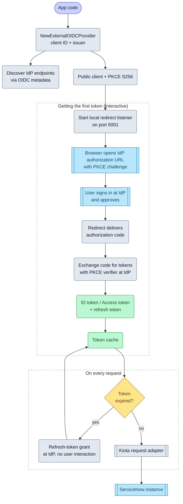

# External OIDC authentication

import GoSnippet from '@site/src/components/GoSnippet';
import authGo from '@site/snippets/auth.go';

The External OIDC flow lets the SDK authenticate users via a third-party
OpenID Connect identity provider (IdP) such as Microsoft Entra ID, Okta,
Auth0, or ADFS. The SDK discovers the IdP's endpoints, runs the
Authorization Code + PKCE flow against the IdP, and presents the resulting
token (ID token by default, or access token when configured) as the Bearer
token to ServiceNow.

## Objective

Configure and use External OIDC authentication with the Service‑Now SDK
using values provided by your ServiceNow administrator and IdP administrator.

## Prerequisites

- A ServiceNow instance with the **OpenID Connect Provider (OIDP)** plugin
  enabled and a third-party OIDP record configured.
- An application registered in your IdP (Entra ID, Okta, Auth0, ADFS, etc.)
  with:
  - **Authorization Code + PKCE** grant type enabled
  - **Redirect URI** configured (e.g., `http://localhost:5001/callback`)
  - **Client ID** (public client, no secret)
  - **Scopes**: at minimum `openid`; add `profile`, `email`, or custom
    audience scopes as needed
- The IdP's issuer URL or full metadata URL (e.g.,
  `https://login.microsoftonline.com/{tenant}/v2.0` or
  `https://login.microsoftonline.com/{tenant}/v2.0/.well-known/openid-configuration`)

## Required values

Your administrators must provide:

| Value | Description |
| ----- | ----------- |
| Service‑Now URL | Base URL of the instance (e.g., `https://dev12345.service-now.com`) |
| Client ID | From the IdP application registration (public client, no secret) |
| Issuer URL | The OIDC issuer URL or full metadata URL |

Optional values:

| Value | Description |
| ----- | ----------- |
| Token source | `id_token` (default, TTL from `exp` claim) or `access_token` (audience-scoped) |
| Audience | Audience claim for access token (required when using access token) |
| Scopes | OAuth2 scopes (default: `openid`) |
| Allowed hosts | Hosts to which the provider will send credentials (defaults to instance host) |
| Token store | Optional persistence for token reuse across restarts |

## ServiceNow configuration

### IdP application registration

1. Register a **public client** (no client secret) in your IdP.
2. Enable **Authorization Code + PKCE** grant type.
3. Add redirect URI: `http://localhost:5001/callback` (or your custom
   redirect URI/port).
2. Add required scopes: `openid` (minimum), plus `profile`, `email`, or
   custom audience scopes as needed.

### ServiceNow OIDP record

1. In ServiceNow, navigate to **OpenID Connect Provider** > **Providers**.
2. Create a new **Third-party OIDP record**.
3. Configure:
   - **Issuer URL**: Your IdP's issuer URL (e.g.,
     `https://login.microsoftonline.com/{tenant}/v2.0`).
   - **Client ID**: The client ID from your IdP app registration.
   - **User claim mapping**: Map the IdP's user claim (e.g., `upn`,
     `email`, `preferred_username`) to the ServiceNow `sys_user` field
     (typically `user_name` or `email`).
   - **JWT verification**: Disable for Entra ID v2.0 metadata; enable for
     other IdPs as appropriate.

## SDK flow



## Initialize the SDK

<GoSnippet language="go" src={authGo} region="auth_external_oidc" />

## Token source: ID token vs Access token

By default, the provider uses the **ID token** as the Bearer token. The ID
token's lifetime (from the `exp` claim) determines the cache TTL.

To use the **access token** instead (for audience-scoped access to
ServiceNow APIs), set the token source:

```go
cred, err := credentials.NewExternalOIDCProvider(
    "client-id",
    credentials.ExternalOIDCOptions{
        CommonOptions: credentials.CommonOptions{
            AllowedHosts: []string{"myinstance.service-now.com"},
        },
        Issuer:       "https://login.microsoftonline.com/{tenant}/v2.0",
        TokenSource:  credentials.ExternalOIDCTokenSourceAccessToken,
        Audience:     "api://service-now-instance", // required for access token
    },
)
```

| Token source | Default TTL | Use case |
| ------------ | ----------- | -------- |
| `id_token` (default) | From `exp` claim in ID token | User identity propagation |
| `access_token` | From `exp` claim in access token | Audience-scoped API access |

When using `access_token`, you **must** provide the `Audience` that
matches the access token's `aud` claim.

## Scopes

Default scopes are `openid`. Add additional scopes as needed:

```go
cred, err := credentials.NewExternalOIDCProvider(
    "client-id",
    credentials.ExternalOIDCOptions{
        CommonOptions: credentials.CommonOptions{
            AllowedHosts: []string{"myinstance.service-now.com"},
            Scopes:       []string{"openid", "profile", "email", "api://service-now/.default"},
        },
        Issuer: "https://login.microsoftonline.com/{tenant}/v2.0",
    },
)
```

## Redirect URI and port

The SDK starts a local HTTP server on port `5001` by default to receive the
authorization code redirect. Configure a custom port or redirect URI via
`AuthorizationCodeOptions`:

```go
cred, err := credentials.NewExternalOIDCProvider(
    "client-id",
    credentials.ExternalOIDCOptions{
        CommonOptions: credentials.CommonOptions{
            AllowedHosts: []string{"myinstance.service-now.com"},
        },
        Issuer: "https://login.microsoftonline.com/{tenant}/v2.0",
    },
    credentials.AuthorizationCodeOptions{
        CommonOptions: credentials.CommonOptions{
            AllowedHosts: []string{"myinstance.service-now.com"},
        },
        Port: 8080, // custom port
    },
)
```

Wait - the current API doesn't support mixing `ExternalOIDCOptions` with
`AuthorizationCodeOptions` directly. The external OIDC provider uses
hardcoded defaults for the authorization code flow (port 5001, default
state generator, browser opener). If you need custom redirect behavior,
see the **Advanced** section below.

## Advanced: Custom redirect server

For advanced scenarios (custom redirect URI, custom port, non-browser
environments), you can provide a custom `ServerFactory`:

```go
cred, err := credentials.NewExternalOIDCProvider(
    "client-id",
    credentials.ExternalOIDCOptions{
        CommonOptions: credentials.CommonOptions{
            AllowedHosts: []string{"myinstance.service-now.com"},
        },
        Issuer: "https://login.microsoftonline.com/{tenant}/v2.0",
    },
    // Note: Current API requires customization through the underlying
    // authorization code client. See the provider source for details.
)
```

For most users, the defaults (port 5001, system browser) work correctly.

## IdP-specific guidance

### Microsoft Entra ID (Azure AD)

- **Metadata URL**: `https://login.microsoftonline.com/{tenant}/v2.0/.well-known/openid-configuration`
- **Issuer**: `https://login.microsoftonline.com/{tenant}/v2.0`
- **JWT verification**: Disable in OIDP record (Entra ID v2.0 uses `x5c`
  header not in metadata)
- **User claim**: Map `upn` to `sys_user.user_name` or `email` to
  `sys_user.email`
- **Scopes**: `openid profile email` + `api://service-now-instance/.default`
  for access token

### Okta

- **Metadata URL**: `https://{your-okta-domain}/oauth2/default/.well-known/openid-configuration`
- **Issuer**: `https://{your-okta-domain}/oauth2/default`
- **User claim**: Map `preferred_username` or `email` to `sys_user`
- **Access token audience**: Use `api://your-service-now-instance`

### Auth0

- **Metadata URL**: `https://{your-tenant}.auth0.com/.well-known/openid-configuration`
- **Issuer**: `https://{your-tenant}.auth0.com/`
- **User claim**: Map `email` or `nickname` to `sys_user`
- **Access token audience**: Set in Auth0 API settings

### ADFS

- **Metadata URL**: `https://adfs.example.com/adfs/.well-known/openid-configuration`
- **Issuer**: `http://adfs.example.com/adfs/services/trust`
- **User claim**: Map `upn` or `email` to `sys_user`

## Token lifecycle

- **Cache**: Tokens are cached in memory and optionally persisted via
  `TokenStore`. The ID token's `exp` claim determines the cache TTL (with a
  20-second clock skew buffer).
- **Refresh**: On cache miss or expiry, the SDK uses the refresh token to
  obtain a new token set from the IdP (no user interaction).
- **Revocation**: On revoke, the SDK attempts to revoke at the IdP's
  revocation endpoint. If the IdP has no revocation endpoint, the local
  token is cleared and the operation succeeds (best-effort).
- **Persistence**: Configure a `TokenStore` in `CommonOptions` to survive
  process restarts.

## Troubleshooting

| Symptom | Likely cause | Resolution |
| ------- | ------------ | ---------- |
| "User Not Authenticated" from ServiceNow | OIDP user claim mapping mismatch | Verify OIDP user claim maps to correct `sys_user` field |
| "Invalid token" from ServiceNow | Token audience/issuer mismatch | Verify OIDP record issuer matches IdP issuer; check audience for access token |
| "Invalid grant" during code exchange | PKCE verifier mismatch / redirect URI mismatch | Ensure redirect URI matches IdP registration exactly; PKCE is automatic |
| "Discovery failed" | Issuer URL wrong or metadata unreachable | Verify issuer URL; check network connectivity to IdP |
| "JWT verification failed" in ServiceNow logs | JWT verification enabled but metadata lacks keys | Disable JWT verification in OIDP record for Entra ID; ensure JWKS URL in metadata for other IdPs |

## Complete example

```go
package main

import (
	"log"

	servicenowsdkgo "github.com/michaeldcanady/servicenow-sdk-go/v3"
	"github.com/michaeldcanady/servicenow-sdk-go/v3/credentials"
)

func main() {
	cred, err := credentials.NewExternalOIDCProvider(
		"your-client-id",
		credentials.ExternalOIDCOptions{
			CommonOptions: credentials.CommonOptions{
				AllowedHosts: []string{"myinstance.service-now.com"},
				Scopes:       []string{"openid", "profile", "email"},
			},
			Issuer:      "https://login.microsoftonline.com/{tenant}/v2.0",
			TokenSource: credentials.ExternalOIDCTokenSourceIDToken, // default
		},
	)
	if err != nil {
		log.Fatal(err)
	}

	client, err := servicenowsdkgo.NewServiceNowServiceClient(
		servicenowsdkgo.WithAuthenticationProvider(cred),
		servicenowsdkgo.WithInstance("https://myinstance.service-now.com"),
	)
	if err != nil {
		log.Fatal(err)
	}

	// Client is now authenticated and ready to use
	_, _ = client.Now().Table("incident").Get(context.Background(), nil)
}
```

## Next steps

- **[Table Operations](../tables/index.mdx):** Interact with ServiceNow tables.
- **[Attachments](../attachments/index.mdx):** Upload and download file attachments.
- **[Batch API](../batch.mdx):** Execute multiple operations in a single request.