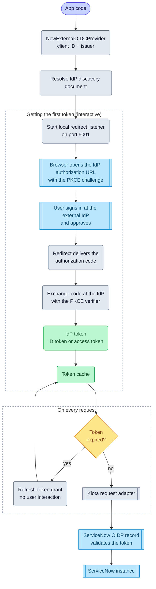

# External OIDC

import GoSnippet from '@site/src/components/GoSnippet';
import authGo from '@site/snippets/auth.go';

External OIDC authentication signs a user in through your organization's
third-party identity provider (external IdP), such as Microsoft Entra ID,
Okta, Auth0, Google, or ADFS, and lets the SDK call ServiceNow on that user's
behalf. The SDK acts as an OIDC client: it resolves the IdP's discovery
document, runs an authorization code + PKCE grant as a public client, and
presents the resulting token verbatim to ServiceNow.

The external IdP is the token authority for this flow, not ServiceNow. ServiceNow
validates the token through an OIDP record; the SDK performs no token validation.

## Objective

Configure and use external OIDC authentication with the ServiceNow SDK against
a standards-compliant OpenID Connect issuer, using values from your identity
administrator and your ServiceNow administrator.

## Required values

Your identity administrator registers the application and provides:

| Value         | Description                                                                          |
| ------------- | ------------------------------------------------------------------------------------ |
| Client ID     | The application (client) ID from the IdP app registration                             |
| Issuer URL    | The IdP's issuer, or its full `/.well-known/openid-configuration` URL                 |
| Redirect URL  | Must match a redirect URL registered on the IdP app                                   |
| Audience scope | Only for an audience-scoped access token, for example `api://{clientId}/.default` on Entra ID |

Your ServiceNow administrator configures an OIDP record with:

| Value            | Description                                                                         |
| ---------------- | ----------------------------------------------------------------------------------- |
| Client ID        | Must equal the `aud` claim in the token the SDK presents                             |
| User claim       | A claim, such as `upn` or `preferred_username`, that maps to a `sys_user` record     |
| Metadata URL     | The IdP's OpenID Connect metadata URL; for Entra ID, use the v1 URL                  |
| JTI verification | Off when the IdP doesn't emit a `jti` claim, which Entra ID doesn't                  |

## SDK flow

## Set up the identity provider

1. Register an application in the external IdP, and add the redirect URL that
   the SDK's local listener uses. The default redirect URL uses port `5001`;
   change the port with `WithPort` or supply your own redirect setup with
   `WithServerFactory`.
2. For the default ID token path, grant the `openid` scope. Add an audience
   scope instead when you want an audience-scoped access token.
3. Record the application (client) ID and the issuer URL for the SDK and the
   OIDP record.

## Set up the ServiceNow OIDP record

Create an OIDP record that trusts the external IdP, then set:

- **Client ID** to the token's `aud` claim. For the ID token path, this is the
  IdP application (client) ID. For the access token path, this is the token
  audience, for example `api://{clientId}`.
- **User claim** to a claim that identifies the user, so ServiceNow can resolve
  a `sys_user` record.
- **Metadata URL** to the IdP's OpenID Connect metadata URL. For Entra ID, use
  the v1 URL; v2 access tokens don't validate.
- **JTI verification** off when the IdP doesn't emit a `jti` claim.

## Choose the presented token

The SDK presents one token verbatim. Pick the path that matches how the IdP app
and the OIDP record are configured:

| Path                       | Configure with                          | Presented token     | OIDP record Client ID       |
| -------------------------- | --------------------------------------- | ------------------- | --------------------------- |
| ID token (default)         | No scopes (scope `openid`)              | The ID token        | The IdP application (client) ID |
| Audience-scoped access token | `WithScopes("api://{clientId}/.default")` | The user access token | The token audience, such as `api://{clientId}` |

The SDK performs no token-type detection. It presents whichever JWT the
configured scopes produce, and the OIDP record validates it.

## Initialize the SDK

Use the default ID token path when the OIDP record's Client ID is your IdP
application (client) ID:

<GoSnippet language="go" src={authGo} region="auth_external_oidc" />

For an audience-scoped access token, add the audience scope:

<GoSnippet language="go" src={authGo} region="auth_external_oidc_scopes" />

## Troubleshooting "User Not Authenticated"

ServiceNow returns `User Not Authenticated` (HTTP 401) when the OIDP record
rejects the token. The SDK performs no token validation, so this response is
always an OIDP configuration problem. Check these causes:

| Cause                                                        | Fix                                                                                                     |
| ------------------------------------------------------------ | ------------------------------------------------------------------------------------------------------- |
| The OIDP record's Client ID doesn't equal the token's `aud`   | Set the record's Client ID to the token audience: the IdP client ID for the ID token path, or `api://{clientId}` for the access token path |
| No user claim maps to a `sys_user` record                     | Map a claim that carries the user identity, such as `upn` or `preferred_username`, in the OIDP record    |
| JTI verification rejects a token that has no `jti` claim      | Turn off JTI verification when the IdP, such as Entra ID, doesn't emit `jti`                             |
| The token is a v2 access token or an opaque token             | Use the Entra ID v1 metadata URL and an ID token or a v1 audience-scoped access token                    |
| The token is a client-credentials (machine) token             | Machine identity is unsupported through the OIDP; use the native [Client Credentials](./client-credentials.mdx) grant |

To tell the failure sides apart in code: a token the IdP couldn't issue
surfaces as `credentials.ErrTokenAcquisition`, and a ServiceNow rejection
surfaces as `*core.UnauthorizedError`, which matches `errors.ErrNotAuthenticated`
through `errors.Is`.

## IdP compatibility

ServiceNow's OIDP record accepts either an ID token or a user access token,
as long as the token is a JWT whose `aud` equals the record's Client ID. The
table captures the per-provider specifics.

| IdP                | Accepted token                   | OIDP Client ID (`aud`)                     | User claim       | Notes                                                         |
| ------------------ | -------------------------------- | ------------------------------------------ | ---------------- | ------------------------------------------------------------- |
| Microsoft Entra ID | ID token (default) or v1 access token | IdP client ID, or `api://{clientId}`   | `upn`            | Use the v1 metadata URL; Entra ID doesn't emit `jti`, so turn off JTI verification |
| Okta               | ID token                         | IdP client ID                              | `sub`            | ServiceNow publishes an Okta ID-token example                 |
| Auth0              | ID token or access token         | Client ID, or the Auth0 API identifier     | `sub`            | Custom claims require an Auth0 Action before they appear      |
| Google             | ID token only                    | IdP client ID                              | `email` or `sub` | Google access tokens are opaque, so the OIDP can't validate them |
| AD FS              | ID token or access token         | Client ID, or the AD FS resource identifier | `upn` or `email` | Both tokens are JWTs; no ServiceNow walkthrough is published  |

## Sources

- ServiceNow docs, [Configure an OAuth OIDC provider for accepting third-party token](https://www.servicenow.com/docs/r/platform-security/authentication/add-OIDC-entity.html): the record verifies ID tokens; the Client ID must equal the `aud` claim; templates exist for ADFS, Auth0, Azure AD, Google, and Okta.
- ServiceNow blog, [Federated Token Authentication for ServiceNow API Access (Inbound)](https://www.servicenow.com/community/platform-privacy-security-blog/federated-token-authentication-for-servicenow-api-access-inbound/ba-p/3367827): ServiceNow accepts either ID tokens or access tokens.
- ServiceNow community, [External OIDC provider with an inbound REST call](https://www.servicenow.com/community/developer-forum/is-it-possible-to-use-an-external-oidc-provider-with-an-inbound/m-p/1673997): for Auth0, set the OIDP Client ID to the token audience, not the client ID.
- Microsoft Learn, [AD FS OpenID Connect/OAuth concepts](https://learn.microsoft.com/en-us/windows-server/identity/ad-fs/development/ad-fs-openid-connect-oauth-concepts): AD FS issues both an ID token and an access token as JWTs.
- Google OAuth access tokens are opaque, not JWTs.
